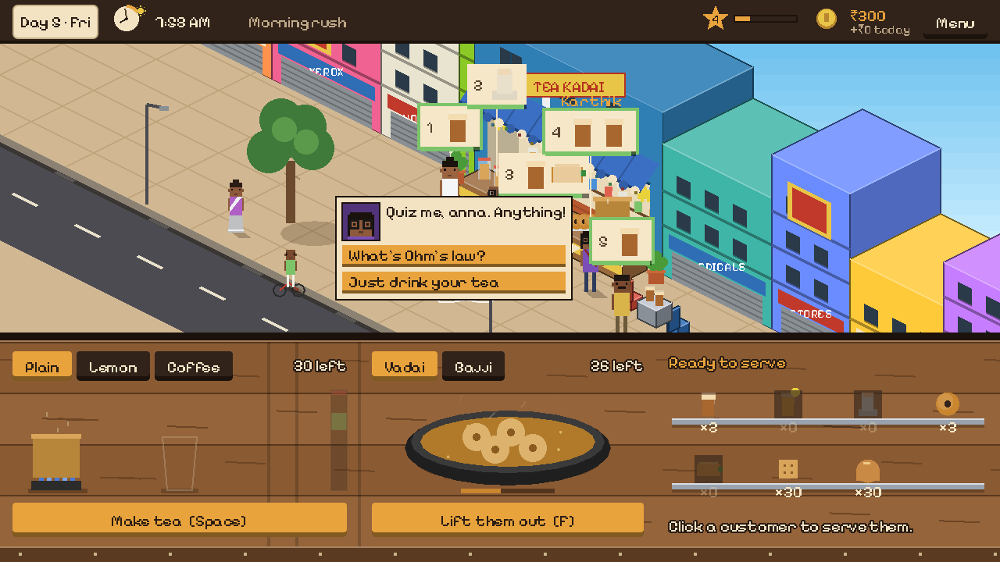

# Tea Kadai

[](https://github.com/praveenjuge/tea-kadai/actions/workflows/release.yml)
[](https://github.com/praveenjuge/tea-kadai/releases/latest)

A cozy pixel-art shop sim about running a little tea kadai on a busy Chennai street. Make tea by hand, fry vadai and bajji, get to know your regulars, and grow the shop week by week.

[](https://github.com/praveenjuge/tea-kadai/releases/latest/download/TeaKadai-macOS.zip)
[](https://github.com/praveenjuge/tea-kadai/releases/latest/download/TeaKadai-Windows.exe)
[](https://github.com/praveenjuge/tea-kadai/releases/latest/download/TeaKadai-Linux.tar.gz)



## Install

- **Mac** (Intel and Apple Silicon): unzip `TeaKadai-macOS.zip` and open Tea Kadai. The app isn't notarized, so the first time macOS blocks it: open **System Settings → Privacy & Security**, scroll down, and click **Open Anyway**.
- **Windows**: run `TeaKadai-Windows.exe`. If SmartScreen appears, click **More info → Run anyway**.
- **Linux**: extract `TeaKadai-Linux.tar.gz` and run `TeaKadai-Linux.x86_64`.

Every push to `main` builds all three and publishes them as a new patch release. If pushes land close together, only the newest one is built and released.

## Run from source

Needs [Godot 4.7](https://godotengine.org/) (`brew install --cask godot` on a Mac).

```bash
godot --path .
```

Skip the title and morning and go straight to service:

```bash
godot --path . -- --service
```

Or open the folder in the Godot editor and press Play.

### Build the apps yourself

With Godot's 4.7.2 export templates installed:

```bash
godot --headless --path . --export-release "macOS" build/TeaKadai-macOS.zip
godot --headless --path . --export-release "Windows" build/TeaKadai-Windows.exe
godot --headless --path . --export-release "Linux" build/TeaKadai-Linux.x86_64
```

## How a day works

1. **Title:** continue your saved week or start a new kadai (with a short opening story). The game saves at the start of every morning.
2. **Morning:** read the paper (with the weather forecast), check the week ahead, and buy from the market stalls. Set your prices. The game is paused while you plan.
3. **Service (about 5 minutes):** morning rush, quiet afternoon, evening rush, closing time. Customers stand at the counter with what they want in a bubble; a green border means everything they want is ready. Nobody walks out: people who wait too long grumble and skip the tip. About one day in three it rains, and everyone wants tea.
4. **Night:** the day's takings count up, you get one to three stars, a line about what Karthik is up to, and upgrades to buy.

You can't lose. A bad day just means less money for tomorrow.

### Regulars

**Karthik**

A broke, dreamy engineering student who drops by every day. He chats, asks you things, and after a couple of days just orders "the usual" (remember it for a bonus). Get friendly and he teaches you ginger tea, brings his friends, and tips double. His story runs across the first week.

**Murugan**, an auto driver saving for his own auto, starts coming by in week 2.

### Growing the kadai

Happy customers earn reputation. Each kadai level puts something new on the menu: lemon tea, bajji, filter coffee, samosa. Every week has three goals with a reward each.

Press **Grow** (on the top bar, in the morning or at night) to spend your money on:

- **Helpers**: flask boys, office tea runners, bus stand carts and more. They earn on their own, all day, and half as much while the game is closed (up to 8 hours). Buy as many as you like; each costs a little more than the last.
- **Staff**: a chai boy who serves ready orders, Cousin Ravi who makes the drinks people are waiting for, and a vadai master at the fryer. They step in when you leave their station alone for a few seconds.
- **Boosts**: one-time buys that double a helper, every helper, your tips, or how often golden glasses appear.

Now and then a **golden glass** floats over the street. Click it before it fades for a lump of money or a helper frenzy.

Once a kadai has earned ₹1 lakh, you can **open a branch** in another part of Chennai from the night screen. You start fresh there, but keep your recipes and regulars, and every branch adds 25% to all earnings for good.

### Upgrades

Bench, bigger milk pot, fresh paint and sign, plants and string lights, table fan, radio and posters, bigger counter, lit signboard. Most unlock at a kadai level, and each one shows on the stall.

## Controls

The game is mouse first. Keys are optional shortcuts.

| Action | Mouse | Key |
| --- | --- | --- |
| Make a glass of tea | Press Make tea | Space |
| Pour (hold, let go in the green) | Hold the tea button | Hold Space |
| Pick the next drink (once there are several) | The drink switches | G |
| Fry a batch of 4, then lift them out when golden | Fry button, or click the kadai | F |
| Pick vadai or bajji (once bajji unlocks) | The fry switches | B |
| Serve a customer | Click them or their bubble | 1 to 5 |
| Answer a customer's question | Click an answer | |
| Pause menu | Menu | P or Esc |
| Sound on/off | | M |

## Sound

All sounds are placeholders synthesized by `tools/make_sounds.gd` into `assets/sounds/`. To replace one, drop in a real recording with the same file name. To regenerate them:

```bash
godot --headless --path . -s tools/make_sounds.gd
godot --headless --path . --import
```

All input goes through named actions in `scripts/core/controls.gd`, so touch and controller support can be added there later.

## Tests

```bash
godot --headless --path . --import
godot --headless --path . -s tests/test_core.gd
godot --path . -s tests/test_play.gd
godot --path . -s tests/test_week.gd
```

- `test_core.gd` checks the rules and has a careful bot play two weeks, printing each day so the pacing can be judged.
- `test_week.gd` is a bug sweep: it plays nine days of the real game at high speed, through the week-1 finale and Murugan's first day.
- `test_play.gd` plays the real game through mouse and keyboard events: title, market, service, pause menu, Karthik's visit, night, the next morning, and quitting to the title. It opens a window and uses its own save file. Add `--write-movie play.avi --fixed-fps 30` to record it.

## Layout

```
scripts/data/catalog.gd     All tunable numbers: menu, market, customers, day phases, upgrades, weather
scripts/data/story.gd       The regulars and their week of story
scripts/core/               Game rules, no drawing: state, saving, settings, clock, tea, fryer, service, regulars
scripts/ui/                 Screens, placeholder art drawn in code, and the sound board
assets/sounds/              Sound effects, ambience and music (placeholders for now)
assets/fonts/               Pixelify Sans (SIL Open Font License)
tools/make_sounds.gd        Synthesizes the placeholder sounds
tests/                      Headless rule checks and an input-driven play test
docs/PLAN.md                The game plan
.github/workflows/          Builds and releases on every push to main
website/                    The download site, deployed by Cloudflare Workers
```

## Website

[tea-kadai.praveenjuge.com](https://tea-kadai.praveenjuge.com) is the plain static site in `website/public/`. It runs on Cloudflare Workers (static assets only), and Cloudflare's Git integration deploys it on every push to `main` that touches `website/`. Website-only pushes don't make a new game release. The download buttons always point at the latest release.

Preview it locally:

```bash
cd website && npx wrangler dev
```

## Licence

[MIT](LICENSE), for the code, art, sounds and story. The Pixelify Sans font is by the Pixelify Sans Project Authors under the [SIL Open Font License](assets/fonts/OFL.txt).
